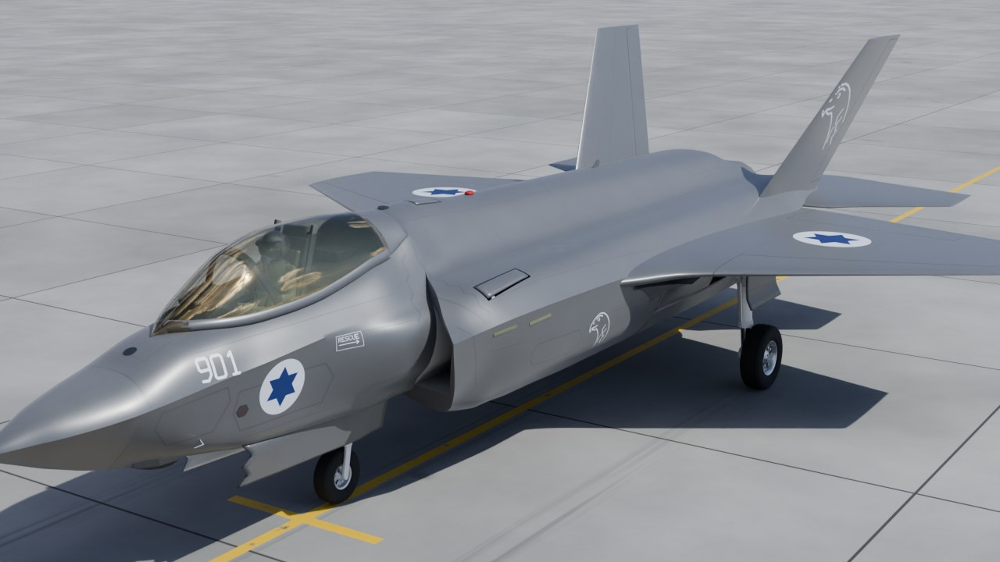

# F-35I "Adir": procedural, rigged and destructible Blender model

A fully scripted (Python / `bpy`) 3D model of the Israeli Air Force F-35I Adir,
built only from publicly available reference material (see [`docs/research.md`](docs/research.md)).

**Status:** the model, rig, damage system and animation clips are done; a ~19 minute making-of video
is assembled from the renders by [`scripts/video/make_video.py`](scripts/video/make_video.py).
`renders/progress/` holds the build history and `blend/history/` a saved .blend for every milestone.



**Animations** (MP4 in [`renders/animation/`](renders/animation), small GIF previews in
[`renders/gifs/`](renders/gifs)): turntable, landing-gear retraction, canopy, pilot head look, cockpit
start-up, flight controls, weapon bays, afterburner run-up, walk-around and a destruction sequence
([`destruction_v6.mp4`](renders/animation/destruction_v6.mp4)).

## What is in the model
* **Airframe:** fuselage with DSI inlets (compression bump and swept cowl lips traced from the front drawing), wings, canted twin tails, all-moving stabilators,
  F135 nozzle (15 outer flaps, pale ceramic divergent flaps, opens for afterburner, with a flickering
  volumetric afterburner flame and shock diamonds) standing free
  behind a sawtooth shroud with the stabilator booms beside it, one-piece canopy, cockpit with the
  large panoramic display. Sensors and small parts placed from photos: faceted EOTS window under the chin,
  six DAS windows, L-shaped air-data probes, formation light strips on the inlets.
* **Undercarriage:** nose and main gear with solved retraction kinematics, doors sequenced to the legs
  (two long nose-gear doors with sawtooth fronts that stay open beside the leg, as on the real jet),
  wheels that spin with the distance rolled, nose-wheel steering.
* **Weapon bays:** both internal bays with doors, a GBU-31 JDAM and an AIM-120 AMRAAM in each.
* **Pilot:** modelled separately in detail ([`scripts/pilot/`](scripts/pilot), studio file
  [`blend/F-35I_Pilot.blend`](blend), renders in [`renders/pilot/`](renders/pilot)): a 1.78 m body
  in the IAF olive flight suit with a white T-shirt at the collar, Israeli flag and unit patches on the
  sleeves, pen pocket, survival vest with pouches, harness with leg straps, G-suit with its hose and
  abdominal bladder, sage Nomex gloves with grey leather palms, laced black leather boots, a steel dive
  watch and a tablet kneeboard. The F-35 Gen III helmet (HMDS) has a carbon shell, the brow display
  module with the night-vision camera, the wrap-around visor on its pivots, ear cups, the oxygen mask with
  its corrugated hose and the helmet cable to the seat. In the jet the pilot sits in the ejection seat (the
  seat bucket set for a 1.78 m pilot, eyes at the design eye), hands on the side-stick and throttle through IK,
  boots on the rudder pedals; the head looks left / right / up / down and tilts.
* **Cockpit switches:** 24 switches, each moves its lever (and guard), lights its LED when the battery
  is on, and drives the system it commands (lights, display, gear, bays, canopy, hook ...).
* **Paint and light:** dark grey under a satin clear coat, tuned against two photos rendered from their
  solved cameras, so sides read charcoal and sky-facing panels read silver as on the real jet. The
  scene is lit by a CC0 partly cloudy airfield sky (HDRI from Poly Haven) with a matched sun lamp.
* **Damage model:** 30 hitboxes, health per component, intact flight attributes and what each kind of
  damage changes (tilt after losing a wing, top speed after engine damage, fuel leaks, gear collapse ...).
  Parts break off with burnt, torn edges, the skin gets soot and scorch marks, smoke and fuel-vapour trails.
  Full description: [`docs/damage_model.md`](docs/damage_model.md).

## Layout
| Path | Contents |
| --- | --- |
| `scripts/build_f35i.py` | Entry point: builds the whole aircraft into a fresh scene |
| `scripts/f35/` | Modules: fuselage, wings, fillets, tails, nozzle, canopy, cockpit, gear, bays, pilot, markings, panels, normals (clean shading over boolean seams), rig, destruct, anim ... |
| `scripts/pilot/` | The detailed pilot: numpy signed-distance solids meshed by surface nets (`sdf.py`), skeleton and seated pose (`skeleton.py`), body, gloves, boots, helmet and gear, materials, rig with look controls and IK hands (`build_pilot.py`), studio scene and renders (`studio.py`, `run_studio.py`) |
| `scripts/damage/f35_damage.py` | Damage and flight-effects simulator (pure Python, no Blender needed) |
| `scripts/damage/make_report.py` | Generates `docs/damage_model.md` |
| `scripts/review_compare.py` | Orthographic silhouettes registered to the public 3-view drawing, with overlap (IoU) |
| `scripts/preview.py`, `scripts/render/` | Review renders, photo-matched cameras (`review.py`), background clip renders (`launch.py`, `clips.py`) |
| `scripts/tools/overlay.py` | Draws the model's outline and edges over a reference photo |
| `scripts/tools/clearance.py` | Landing-gear checks: nothing outside the skin with the gear up, no part through a door during the swing |
| `data/camera_matches/` | Cameras solved from reference photos (position, rotation, lens) |
| `references/hdri/` | The sky the scene is lit by (CC0, Poly Haven, 2k). `scripts/tools/get_hdri.py` fetches the 4k / 8k copies that renders use for sharper backgrounds |
| `blend/F-35I_Adir.blend` | The built model, ready to open in Blender 5.1 |
| `blend/F-35I_Pilot.blend` | The pilot standing in a small photo studio (rigged: `head_yaw`, `head_pitch`, `head_tilt` on `Pilot_Rig`) |
| `blend/history/` | One blend per milestone with an index of what changed and the mesh counts ([`INDEX.md`](blend/history/INDEX.md)); `scripts/tools/blend_history.py add <name>` appends the current one |
| `data/damage_model.json` | Components, hitboxes, intact attributes and ground attitudes, exported by the build |
| `scripts/render/` | Background renders: `clips.py` (all animation clips), `launch.py` (start one from a running Blender), `chain.py` (run several in a row), `history_stills.py` (stills of every saved version) |
| `scripts/video/` | `make_video.py` assembles the making-of in Blender's sequencer; `code_pages.py` renders the source-code and result-table pages it shows |
| `renders/` | `progress` (numbered stills), `animation` (MP4), `gifs`, `history` (each saved version from three fixed cameras), `video` (pages and clips for the making-of, `chapters.txt`) |

## Build
```bash
pip install bpy==5.1.2            # or run inside Blender 5.1
python3 scripts/build_f35i.py --out blend/F-35I_Adir.blend
python3 scripts/damage/make_report.py     # regenerate the damage report
```

## The pilot, modelled separately
```bash
# studio file + renders (renders/pilot/<prefix><view>.png); the meshes take ~4 minutes of numpy
blender -b --factory-startup --python scripts/pilot/run_studio.py -- \
    --views front34,side,back34,head34 --samples 96 --ratio 0.5 --prefix v4_
# a 120-frame turntable from the saved studio file (frames in renders/frames/pilot_turntable_<prefix>)
blender -b --factory-startup --python scripts/pilot/run_studio.py -- \
    --open blend/F-35I_Pilot.blend --views "" --turntable 120 --samples 48 --prefix v4_
```
The aircraft build (`f35/pilot.py`) poses the same pilot in the seat and caches its meshes in
`blend/cache/pilot_seated.npz` (rebuilt when the pilot's code or the cockpit targets change).
`scripts/render/pilot_check.py` checks the pilot in the jet: the gap between the helmet and the canopy for
every head pose, the hands on the stick and throttle, and a few stills.

## Checking it against photos
Inside Blender 5.1 (for example through the Blender MCP add-on), with `scripts/render` and
`scripts/tools` on `sys.path`:
```python
import review, clearance
review.match("c29")                  # render from the camera solved for reference photo c29
review.match_edges("c29")            # flat edge render; tools/overlay.py draws it over the photo
clearance.exposed(0.0)               # gear parts outside the closed airframe, gear up: expect {}
clearance.crossings([0, 0.5, 1.0])   # gear edges cutting through skin or doors during the swing
```

## Animating it
Every control is a custom property on the `F35I_Rig` object (Object properties > Custom Properties),
so it can be keyframed or driven. All drivers are "simple expressions" and work with Python auto-run off.

| Property | Range | Moves |
| --- | --- | --- |
| `stick_pitch`, `stick_roll`, `pedals` | -1..1 | stabilators, flaperons (+ differential stabs), rudders, side-stick, pedals |
| `throttle` | 0..1 (0.75 = MIL) | throttle lever, nozzle, afterburner flame with shock diamonds above 0.75 |
| `flaps`, `speedbrake` | 0..1 | flaperons / leading-edge flaps, rudders split outwards |
| `gear` | 0 up .. 1 down | doors and legs, sequenced |
| `nws`, `roll_distance` | -1..1, metres | nose-wheel steering, wheel spin |
| `weapon_bays`, `canopy`, `refuel_door`, `gun_door`, `tailhook` | 0..1 | doors, canopy, hook |
| `head_yaw`, `head_pitch`, `head_tilt` | degrees | pilot head (+ yaw = looks left, + pitch = up) |
| `sw_<NAME>` | 0 / 1 | cockpit switch (lever, guard, LED and its system) |
| `health_<component>` | 0..1 | damage state (soot, smoke, broken parts) |
| `break_frame_<component>` | frame | when a destroyed part tears off and starts to tumble |

Helpers for animation scripts, run inside Blender with `scripts/` on `sys.path`:
```python
from f35 import anim, destruct
anim.start_up(frame=1)                    # pilot powers up the jet, looking at each console
anim.actuate("GEAR", 0, frame=400)        # gear lever up: the gear retracts over 6 s
anim.look(frame=520, yaw=60, pitch=10)    # pilot looks left and up
destruct.impact((6, -1.5, 0.6), (-1, 0.1, -0.1), hp=120, frame=600)   # hit: scorch + damage
destruct.break_off("wing_outer_L", frame=640)                         # outer left wing tears off
destruct.flight_response(frame=640, mach=0.45, alt_m=1000)            # jet banks as the simulator says
destruct.collapse_gear("main_gear_L", frame=900)                      # on the ground: leg folds
```

## Rendering the clips and the making-of video
Clips render in a background Blender so the interactive session stays free:
```python
import launch                      # scripts/render on sys.path, inside Blender 5.1
launch.clips(["gear_retract", "walkaround"], engine="CYCLES", res="1280x720", samples=48, suffix="_v6")
launch.status()                    # tail of the newest log (renders/frames/log_*.txt)
```
The making-of is built from the renders without any 3D rendering (stills with a slow push-in, the
clips, code pages, chapter cards, captions and cross-dissolves):
```bash
blender -b --factory-startup --python scripts/video/make_video.py -- --dry      # chapters + length
blender -b --factory-startup --python scripts/video/make_video.py -- --stills 240,2400   # check frames
blender -b --factory-startup --python scripts/video/make_video.py               # 1080p H.264
```

## Damage model in one paragraph
`scripts/damage/f35_damage.py` holds the intact attributes (public figures where they exist, typical
fighter values marked "model" where they do not) and computes, for any damage state, the thrust,
maximum Mach and speed, g limit, stall and minimum control speeds, the bank and sideslip needed to fly
straight with an asymmetric wing (or the roll-off rate when the jet cannot be held), fuel left, leak rate
and endurance, and which systems still work. For example, losing the outer left wing panel needs about
10° of left bank at 200 kt and none above 300 kt; losing the whole left wing cannot be held below about
370 kt; an engine at 50 % thrust tops out at about Mach 1.08 at 11 km. The tables are in
[`docs/damage_model.md`](docs/damage_model.md).

## Notes
* Only public, non-sensitive references were used. Internal details (systems layout, exact
  aerodynamic coefficients) are approximations for animation and are labelled as such.
* Coordinates: +X = aircraft left, -Y = forward, Z = up; station `s` is metres aft of the radome tip.
