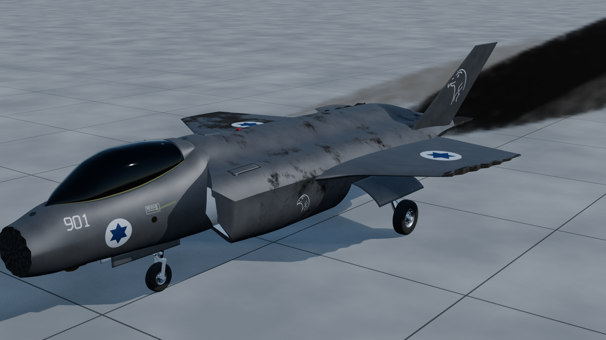

# F-35I "Adir": procedural, rigged and destructible Blender model

A fully scripted (Python / `bpy`) 3D model of the Israeli Air Force F-35I Adir,
built only from publicly available reference material (see [`docs/research.md`](docs/research.md)).

**Status:** work in progress. `renders/progress/` holds the build history.



## What is in the model
* **Airframe:** fuselage with DSI inlets (compression bump and swept cowl lips traced from the front drawing), wings, canted twin tails, all-moving stabilators,
  F135 nozzle (15 outer flaps, pale ceramic divergent flaps, opens for afterburner) standing free
  behind a sawtooth shroud with the stabilator booms beside it, one-piece canopy, cockpit with the
  large panoramic display. Sensors and small parts placed from photos: faceted EOTS window under the chin,
  six DAS windows, L-shaped air-data probes, formation light strips on the inlets.
* **Undercarriage:** nose and main gear with solved retraction kinematics, doors sequenced to the legs
  (two long nose-gear doors with sawtooth fronts that stay open beside the leg, as on the real jet),
  wheels that spin with the distance rolled, nose-wheel steering.
* **Weapon bays:** both internal bays with doors, a GBU-31 JDAM and an AIM-120 AMRAAM in each.
* **Pilot:** seated in the ejection seat, hands follow the side-stick and throttle, head looks
  left / right / up / down and tilts.
* **Cockpit switches:** 24 switches, each moves its lever (and guard), lights its LED when the battery
  is on, and drives the system it commands (lights, display, gear, bays, canopy, hook ...).
* **Paint and light:** dark grey under a satin clear coat, tuned against two photos rendered from their
  solved cameras, so sides read charcoal and sky-facing panels read silver as on the real jet. The
  scene is lit by a CC0 partly cloudy airfield sky (HDRI from Poly Haven) with a matched sun lamp.
* **Damage model:** 30 hitboxes, health per component, intact flight attributes and what each kind of
  damage changes (tilt after losing a wing, top speed after engine damage, fuel leaks, gear collapse ...).
  Parts break off with burnt, torn edges, the skin gets soot and scorch marks, smoke and fuel-vapour trails.
  Full description: [`docs/damage_model.md`](docs/damage_model.md).

## Layout
| Path | Contents |
| --- | --- |
| `scripts/build_f35i.py` | Entry point: builds the whole aircraft into a fresh scene |
| `scripts/f35/` | Modules: fuselage, wings, fillets, tails, nozzle, canopy, cockpit, gear, bays, pilot, markings, panels, normals (clean shading over boolean seams), rig, destruct, anim ... |
| `scripts/damage/f35_damage.py` | Damage and flight-effects simulator (pure Python, no Blender needed) |
| `scripts/damage/make_report.py` | Generates `docs/damage_model.md` |
| `scripts/review_compare.py` | Orthographic silhouettes registered to the public 3-view drawing, with overlap (IoU) |
| `scripts/preview.py`, `scripts/render/` | Review renders, photo-matched cameras (`review.py`), background clip renders (`launch.py`, `clips.py`) |
| `scripts/tools/overlay.py` | Draws the model's outline and edges over a reference photo |
| `scripts/tools/clearance.py` | Landing-gear checks: nothing outside the skin with the gear up, no part through a door during the swing |
| `data/camera_matches/` | Cameras solved from reference photos (position, rotation, lens) |
| `references/hdri/` | The sky the scene is lit by (CC0, Poly Haven, 2k). `scripts/tools/get_hdri.py` fetches the 4k / 8k copies that renders use for sharper backgrounds |
| `blend/F-35I_Adir.blend` | The built model, ready to open in Blender 5.1 |
| `blend/history/` | One blend per milestone with an index of what changed and the mesh counts ([`INDEX.md`](blend/history/INDEX.md)); `scripts/tools/blend_history.py add <name>` appends the current one |
| `data/damage_model.json` | Components, hitboxes, intact attributes and ground attitudes, exported by the build |
| `renders/` | Images and GIFs for the making-of video (`progress`, `turntable`, `gifs`, `animation`, `review`) |

## Build
```bash
pip install bpy==5.1.2            # or run inside Blender 5.1
python3 scripts/build_f35i.py --out blend/F-35I_Adir.blend
python3 scripts/damage/make_report.py     # regenerate the damage report
```

## Checking it against photos
Inside Blender 5.1 (for example through the Blender MCP add-on), with `scripts/render` and
`scripts/tools` on `sys.path`:
```python
import review, clearance
review.match("c29")                  # render from the camera solved for reference photo c29
review.match_edges("c29")            # flat edge render; tools/overlay.py draws it over the photo
clearance.exposed(0.0)               # gear parts outside the closed airframe, gear up: expect {}
clearance.crossings([0, 0.5, 1.0])   # gear edges cutting through skin or doors during the swing
```

## Animating it
Every control is a custom property on the `F35I_Rig` object (Object properties > Custom Properties),
so it can be keyframed or driven. All drivers are "simple expressions" and work with Python auto-run off.

| Property | Range | Moves |
| --- | --- | --- |
| `stick_pitch`, `stick_roll`, `pedals` | -1..1 | stabilators, flaperons (+ differential stabs), rudders, side-stick, pedals |
| `throttle` | 0..1 (0.75 = MIL) | throttle lever, nozzle, afterburner glow above 0.75 |
| `flaps`, `speedbrake` | 0..1 | flaperons / leading-edge flaps, rudders split outwards |
| `gear` | 0 up .. 1 down | doors and legs, sequenced |
| `nws`, `roll_distance` | -1..1, metres | nose-wheel steering, wheel spin |
| `weapon_bays`, `canopy`, `refuel_door`, `gun_door`, `tailhook` | 0..1 | doors, canopy, hook |
| `head_yaw`, `head_pitch`, `head_tilt` | degrees | pilot head (+ yaw = looks left, + pitch = up) |
| `sw_<NAME>` | 0 / 1 | cockpit switch (lever, guard, LED and its system) |
| `health_<component>` | 0..1 | damage state (soot, smoke, broken parts) |
| `break_frame_<component>` | frame | when a destroyed part tears off and starts to tumble |

Helpers for animation scripts, run inside Blender with `scripts/` on `sys.path`:
```python
from f35 import anim, destruct
anim.start_up(frame=1)                    # pilot powers up the jet, looking at each console
anim.actuate("GEAR", 0, frame=400)        # gear lever up: the gear retracts over 6 s
anim.look(frame=520, yaw=60, pitch=10)    # pilot looks left and up
destruct.impact((6, -1.5, 0.6), (-1, 0.1, -0.1), hp=120, frame=600)   # hit: scorch + damage
destruct.break_off("wing_outer_L", frame=640)                         # outer left wing tears off
destruct.flight_response(frame=640, mach=0.45, alt_m=1000)            # jet banks as the simulator says
destruct.collapse_gear("main_gear_L", frame=900)                      # on the ground: leg folds
```

## Damage model in one paragraph
`scripts/damage/f35_damage.py` holds the intact attributes (public figures where they exist, typical
fighter values marked "model" where they do not) and computes, for any damage state, the thrust,
maximum Mach and speed, g limit, stall and minimum control speeds, the bank and sideslip needed to fly
straight with an asymmetric wing (or the roll-off rate when the jet cannot be held), fuel left, leak rate
and endurance, and which systems still work. For example, losing the outer left wing panel needs about
10° of left bank at 200 kt and none above 300 kt; losing the whole left wing cannot be held below about
370 kt; an engine at 50 % thrust tops out at about Mach 1.08 at 11 km. The tables are in
[`docs/damage_model.md`](docs/damage_model.md).

## Notes
* Only public, non-sensitive references were used. Internal details (systems layout, exact
  aerodynamic coefficients) are approximations for animation and are labelled as such.
* Coordinates: +X = aircraft left, -Y = forward, Z = up; station `s` is metres aft of the radome tip.
